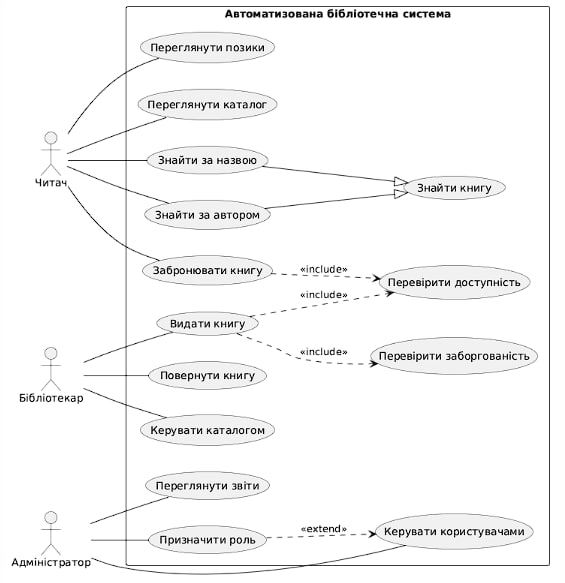
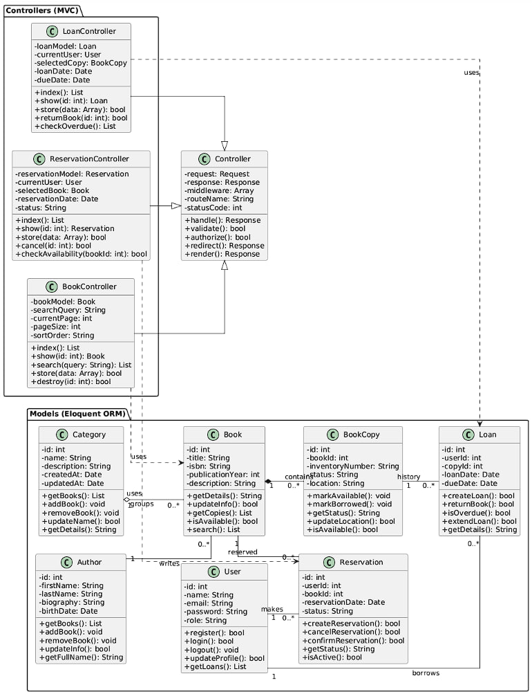

# Автоматизована бібліотечна система

## 1. Опис системи

Автоматизована бібліотечна система призначена для обліку книг, обслуговування читачів та управління бібліотечним фондом.

Система дозволяє виконувати пошук, бронювання, видачу та повернення книг, контролювати терміни повернення та формувати звіти.

### Основні користувачі
- Читач — шукає та бронює книги, переглядає свої позики.
- Бібліотекар — видає та приймає книги, керує каталогом.
- Адміністратор — керує користувачами та переглядає звіти.

### Архітектура

Система проєктується на основі PHP/Laravel з використанням архітектури MVC (Model-View-Controller).

Основні моделі: User, Book, Author, Category, BookCopy, Loan, Reservation.

Основні контролери: BookController, LoanController, ReservationController.

## 2. Use Case: Видача книги читачеві

**Головний актор:** Бібліотекар.

**Передумови:** Бібліотекар авторизований, читач зареєстрований, книга внесена до каталогу.

**Гарантія успіху:** Створено запис про видачу, встановлено термін повернення, статус примірника змінено на "Видано".

### Основний сценарій

1. Читач звертається до бібліотекаря.
2. Бібліотекар відкриває розділ видачі книг.
3. Система відображає форму видачі.
4. Бібліотекар вводить ідентифікатор читача.
5. Система знаходить читача.
6. Система перевіряє прострочені позики.
7. Бібліотекар знаходить книгу в каталозі.
8. Система відображає доступні примірники.
9. Бібліотекар обирає примірник.
10. Система визначає дату видачі та повернення.
11. Бібліотекар підтверджує видачу.
12. Система створює запис у таблиці loans.
13. Система змінює статус примірника.
14. Бібліотекар передає книгу читачеві.

### Альтернативні сценарії

1. Читача не знайдено — система пропонує реєстрацію.
2. Є прострочені позики — видача блокується.
3. Немає доступних примірників — видача неможлива.
4. Операцію скасовано — зміни не зберігаються.
5. Помилка бази даних — система повідомляє про збій.
6. Примірник уже виданий — повторна видача заборонена.

### Додаткові вимоги

Система забезпечує перевірку доступності книг, захист персональних даних і розмежування прав доступу.

**Технологічні особливості:** ідентифікатори читачів і примірників можуть вводитися вручну або сканером штрихкодів.

**Частота використання:** орієнтовно 40% основних операцій обслуговування читачів (проєктне припущення).

**Можливе розширення:** автоматичні нагадування про термін повернення.

## 3. Діаграма варіантів використання

## 4. Діаграма класів

